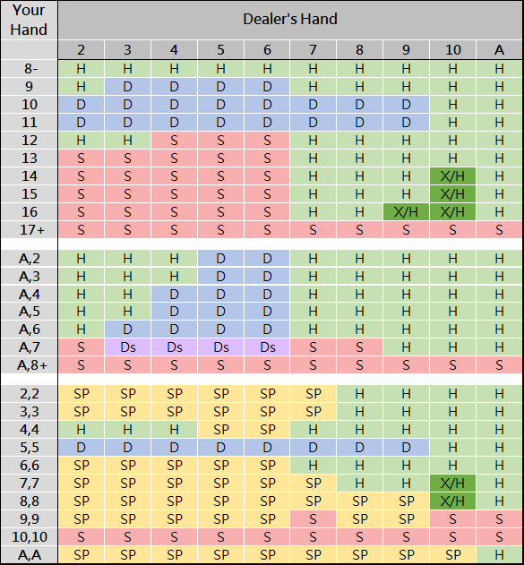

# 歐式 21 點練習

歐式 21 點（莊家無底牌）基本策略練習。

快捷鍵：`H` 要牌、`S` 停牌、`D` 加倍、`P` 分牌、`R` 投降、`Enter` 下一手。

## 練習規則

莊家沒有底牌，玩家行動完才補牌；莊家 Blackjack 時，你加倍、分牌的注碼全輸。
任意兩張可加倍、分牌後可加倍、只能分牌一次、分 A 只發一張。
莊家軟 17 停牌。開局兩張可投降。

## 參考

